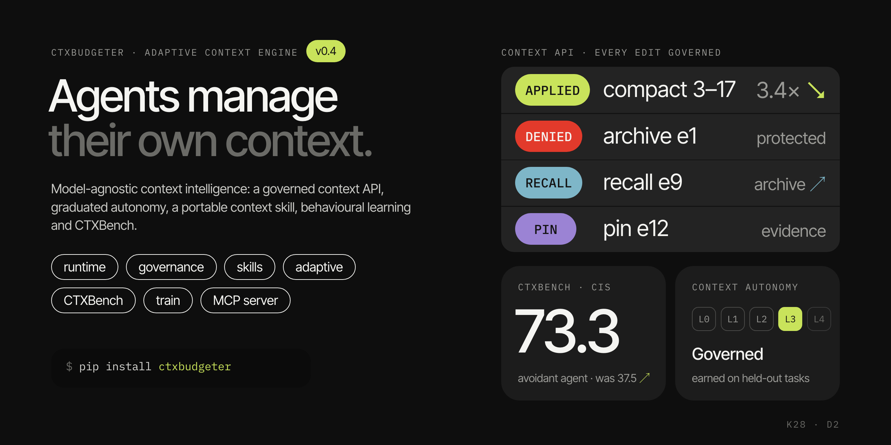
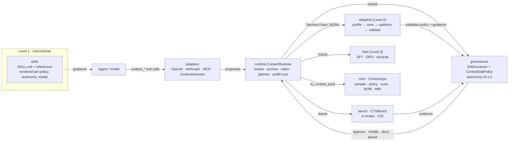

<p align="center">
  
</p>

# ctxbudgeter

[](https://pypi.org/project/ctxbudgeter/)
[](https://pypi.org/project/ctxbudgeter/)
[](https://pepy.tech/projects/ctxbudgeter)
[](https://opensource.org/licenses/MIT)
[](https://github.com/Kayariyan28/ctxbudgeter/actions/workflows/test.yml)


[](https://www.k28art.space/projectcontext)

> **The model-agnostic context intelligence layer for AI agents.**
> It enables, teaches, governs and evaluates how agents manage their context — before every
> model call *and* while the agent runs.

**Explore it live → [k28art.space/projectcontext](https://www.k28art.space/projectcontext)** — the two films
(0.4 and the original), an interactive playground where you propose context edits and watch the
governor decide, the compiler playground, CTXBench results and every module in the archive.

> **If ctxbudgeter saved you tokens, time, or a 3am incident — drop a ⭐ on the [repo](https://github.com/Kayariyan28/ctxbudgeter). It's the fuel for me to keep shipping new features.**

Long-running agents fill their context windows with tool output, documents and their own
turns. Today's harnesses handle that with a blunt rule: when the window fills, summarize the
history. Research shows agents can do better by managing their own context — NVIDIA found
GPT-6.1 Sol nearly triples its score at a 32K budget when it controls compaction itself — but
also that models differ wildly. Some never compact and give up when the window fills, some
compact far too early, some compress until they keep reopening what they threw away.

ctxbudgeter gives you both halves of the answer:

| | **Adaptive Context Engine** (new in 0.4) | **ContextOps** (0.1 – 0.3) |
|---|---|---|
| When | while the agent runs | before every model call |
| What | a governed context API agents use to compact, pin, archive and recall their own history; graduated autonomy; a portable skill; per-model behavioural learning; the CTXBench benchmark; training data | a deterministic compiler that selects, budgets, scans, redacts and audits context, with a Context Bill of Materials, diffing, Context MRI and MCP tool budgeting |
| Guarantee | agents propose, ctxbudgeter governs: protected context can't be removed, originals are archived not deleted, every decision is traced | every included and excluded item has a reason; same inputs, same output |

**ctxbudgeter is not an agent framework.** It sits in front of and alongside LangGraph, CrewAI,
OpenAI Agents SDK, PydanticAI, Microsoft Agent Framework, Claude Code, any MCP client, or your
own loop. No LLM calls in the core; local-first; deterministic.

## See it work

<p align="center">
  
</p>

Every line is real output, recorded by [`docs/demo/make_terminal_svg.py`](docs/demo/make_terminal_svg.py).

<details>
<summary>What the demo shows</summary>

| # | Command | What it proves |
|--:|---------|----------------|
| 1 | `python examples/context_runtime_demo.py` | The context API end to end: the timing verdict, a diagnosis, a cache-aware plan, a governed compaction that keeps 100% of facts, a **denied** attempt to archive the system prompt, recall of an archived original, and a 10% prefill saving from suffix KV reuse |
| 2 | `ctxbudgeter bench -a reckless …` | CTXBench: an agent that edits protected context scores 0 with critical violations when ungoverned, and scores well with **zero** violations under the learned, governed policy |
| 3 | `ctxbudgeter autonomy certify` | Autonomy is earned on evidence — 2 episodes are not enough to promote |
| 4 | `ctxbudgeter profile` | The agent's own traces reveal it as `unsafe`; the tuner proposes explicit, attributable rules |
| 5 | `ctxbudgeter train-export` | Decisions become SFT, DPO preference and reward datasets |
| 6 | `ctxbudgeter skill export` | The portable `context-management` skill, ready for Claude Code or any SKILL.md loader |
| 7 | `ctxbudgeter serve-mcp` | The same governed API for any MCP client |

</details>

## Contents

- [Install](#install)
- [Quick start](#quick-start) — [govern a live agent](#1-govern-a-live-agents-context) · [plug into your loop](#2-plug-into-your-agent-loop) · [MCP clients](#3-use-it-from-claude-code-claude-desktop-or-cursor-mcp) · [the skill](#4-teach-any-agent-with-the-skill) · [benchmark](#5-benchmark-and-improve-an-agent) · [compile context](#6-compile-context-before-a-call)
- [Architecture](#architecture)
- [Part 1 — Adaptive Context Engine](#part-1--adaptive-context-engine)
- [Part 2 — ContextOps](#part-2--contextops)
- [Supported tools and libraries](#supported-tools-and-libraries)
- [CLI reference](#cli-reference)
- [Wire it into CI](#wire-it-into-ci)
- [How it works](#how-it-works)
- [Research foundations](#research-foundations)
- [Positioning](#positioning) · [Design choices](#design-choices) · [Documentation](#documentation) · [Author](#author) · [License](#license)

## Install

```bash
pip install ctxbudgeter
```

| Extra | Adds | When you need it |
|---|---|---|
| `ctxbudgeter[tiktoken]` | `tiktoken` | exact OpenAI token counts (cl100k / o200k); a close proxy for Anthropic |
| `ctxbudgeter[yaml]` | `PyYAML` | YAML pack specs and policy files |
| `ctxbudgeter[http]` | `requests` | the `http_get` loader for just-in-time References |
| `ctxbudgeter[openai]` / `[anthropic]` / `[langchain]` | the SDKs | calling models through the adapters, `LLMContextAgent` |
| `ctxbudgeter[viz]` | `jinja2`, `plotly`, `networkx` | richer Context MRI / MCP map rendering |
| `ctxbudgeter[all]` | everything above | |

Python 3.10 – 3.14 on Linux, macOS and Windows. The only required dependencies are `pydantic`,
`typer` and `rich`. Adapters are lazy-imported, the MCP server needs no MCP SDK, and nothing in
the core calls an LLM.

## Quick start

### 1. Govern a live agent's context

```python
from ctxbudgeter.runtime import ContextRuntime

rt = ContextRuntime(model="gpt-4.1", budget=32_000, reserved_output_tokens=4_000)
rt.add("You are a research agent. Report exact figures.", kind="system")   # protected
rt.add("Find FY2019 receipts for ALPHA-7.", kind="task")                    # protected
rt.add(document_text, kind="document", source="corpus/treasury_2019.txt")
rt.step()                          # book one model request: budget + prefill-cost accounting

rt.budget()["timing"]              # block | defer | allow | compact_now
rt.diagnose()                      # duplicates, conflicting facts, stale logs, secrets
plan = rt.plan()                   # cache-aware edits that reach a target usage
rt.apply_plan(plan)                # or rt.compact("3", "17", summary="...")
rt.archive("1")                    # → denied: protected_context (critical)
rt.recall("9")                     # compacted originals stay recoverable by tag
rt.evaluate()                      # compression, fact retention, reopen rate, prefill saved
```

Run the full version: [`examples/context_runtime_demo.py`](examples/context_runtime_demo.py).

### 2. Plug into your agent loop

`ContextHarness` turns the runtime into model requests and executes the model's `context_*`
tool calls through the governor. Your own tools pass straight through.

**OpenAI**

```python
import json
from openai import OpenAI
from ctxbudgeter.runtime import ContextRuntime
from ctxbudgeter.adapters import ContextHarness

client = OpenAI()
rt = ContextRuntime(model="gpt-4.1", budget=64_000, reserved_output_tokens=4_000)
rt.add("You are a support agent.", kind="system")
rt.add("Answer the customer's refund question.", kind="task")
harness = ContextHarness(rt, provider="openai")        # adds the skill + context tools

while True:
    req = harness.request(extra_tools=MY_TOOLS)         # messages, tools, pressure warning
    msg = client.chat.completions.create(model="gpt-4.1", **req).choices[0].message
    if not msg.tool_calls:
        print(msg.content)
        break
    ctx_results, other_calls = harness.handle_tool_calls(msg.tool_calls)  # governed
    for r in ctx_results:
        rt.add(f"{r['name']} → {json.dumps(r['output'])[:300]}", kind="tool_result", category="compressible")
    for call in other_calls:                             # your tools
        rt.add(run_my_tool(call), kind="tool_result", source=call.function.name)
```

**Anthropic**

```python
from anthropic import Anthropic

client = Anthropic()
harness = ContextHarness(rt, provider="anthropic")

while True:
    resp = client.messages.create(model="claude-sonnet-4-6", max_tokens=2048, **harness.request())
    if resp.stop_reason != "tool_use":
        break
    ctx_results, other_calls = harness.handle_tool_calls(resp.content)    # tool_use blocks
    for r in ctx_results:
        rt.add(f"{r['name']} → {json.dumps(r['output'])[:300]}", kind="tool_result", category="compressible")
    for block in other_calls:
        if getattr(block, "type", None) == "tool_use":
            rt.add(run_my_tool(block), kind="tool_result", source=block.name)
```

Harness can't hand over context editing? Use `ContextHarness(rt, guidance_only=True)`: no
context tools are exposed, autonomy is forced to L1, and the plan is surfaced as advice.
Building tool calls yourself? `openai_tools()`, `anthropic_tools()`, `mcp_tools()` and
`ContextToolDispatcher(rt).call(name, args)` are the building blocks.

### 3. Use it from Claude Code, Claude Desktop or Cursor (MCP)

```bash
# Claude Code
claude mcp add ctxbudgeter -- ctxbudgeter serve-mcp --state .ctx/session.json --allow-add
```

```jsonc
// Claude Desktop (claude_desktop_config.json) or Cursor (.cursor/mcp.json)
{
  "mcpServers": {
    "ctxbudgeter": {
      "command": "ctxbudgeter",
      "args": ["serve-mcp", "--budget", "128000", "--state", ".ctx/session.json", "--allow-add"]
    }
  }
}
```

The server speaks JSON-RPC over stdio (`initialize`, `tools/list`, `tools/call`,
`resources/list`, `resources/read`, `ping`), exposes the 14 `context_*` tools and the skill as
the resource `ctxbudgeter://skills/context-management`, and persists the session, archive and
decision traces next to `--state`. An MCP server can't rewrite a client's *internal* context
window, so over MCP the runtime acts as a governed external working-context store
(`--allow-add` lets the client push events). For full control, embed the runtime (2).

### 4. Teach any agent with the skill

```bash
ctxbudgeter skill export ~/.claude/skills             # Claude Code, or any SKILL.md loader
ctxbudgeter skill show --brief --model kimi-k3        # system-prompt section, tuned to the model
```

```python
from ctxbudgeter import render_guidance
system_prompt += render_guidance(policy=rt.policy, autonomy=3, brief=True)
```

The [`context-management` skill](src/ctxbudgeter/skills/context-management/SKILL.md) teaches
context categories, when to compact (and when not to), how to write summaries that keep
numbers, identifiers and corrections, how to recover archived facts, and how to read governor
denials — with an [API reference](src/ctxbudgeter/skills/context-management/references/api.md)
and [worked good/bad decisions](src/ctxbudgeter/skills/context-management/references/examples.md).

### 5. Benchmark and improve an agent

```bash
ctxbudgeter bench -a competent --budgets 4000,8000 -o report.json --traces traces.jsonl
ctxbudgeter profile traces.jsonl --store .ctxbudgeter/policies    # behaviours → tuned policy
ctxbudgeter autonomy certify report.json                         # promote / hold / demote
ctxbudgeter train-export traces.jsonl -o datasets/               # SFT · DPO · rewards
```

Benchmark a real model instead of a reference agent:

```python
from openai import OpenAI
from ctxbudgeter.bench import BenchRunner, LLMContextAgent, TaskGenerator, openai_complete

tasks = TaskGenerator(seed=7).suite(n=2, stream_tokens=12_000)
agent = lambda: LLMContextAgent(openai_complete(OpenAI(), "gpt-4.1"))
report = BenchRunner(tasks, agent, budgets=[8_000], model="gpt-4.1").run()
print(report.to_markdown())
```

### 6. Compile context before a call

```python
from ctxbudgeter import ContextPack

pack = ContextPack(
    model="claude-sonnet-4.6",
    token_budget=24_000,
    reserved_output_tokens=4_000,
)

pack.add(
    name="system_rules",
    content="You are a careful coding agent...",
    kind="system",
    priority=100,
    cache_policy="stable",
    required=True,
)
pack.add_file("README.md", kind="project_doc", priority=80)
pack.add(
    name="task",
    content="Build the referral packet UI.",
    kind="task",
    priority=95,
    required=True,
)

compiled = pack.compile()
print(compiled.report())
```

```text
Included:
  - system_rules: 312 tokens, required, stable cache prefix, system
  - README.md: 1,420 tokens, stable cache prefix, project_doc
  - task: 19 tokens, required, task

Excluded:
  - old_notes.md: token-heavy and low priority — 8,400 tokens, score 41
  - debug.log: token-heavy and low priority — 14,200 tokens, score 12

Estimated input tokens: 1,751
Reserved output tokens: 4,000
Cacheable prefix: 1,732 tokens
Token budget: 24,000 (utilization 8.8%)
Context health score: 87/100
  breakdown: cacheable_prefix_bonus: +5, under_utilized: -5
Tokenizer: tiktoken
```

## Architecture



*The agent proposes. ctxbudgeter governs. The harness executes. The evaluator teaches.*
Full design: [`docs/context_intelligence.md`](docs/context_intelligence.md).

## Part 1 — Adaptive Context Engine

### The context API (`ctxbudgeter.runtime`)

The agent's working context is a list of tagged events (`[e7 tool_result]`). A summary that
replaced events 3–17 is tagged `3..17`, and its originals move to an append-only archive,
recoverable by tag.

| Operation | What it does |
|---|---|
| `inspect()` | composition by category and kind, every event |
| `budget()` | used / free / usage, pressure level, timing verdict |
| `diagnose()` | duplicates, superseded and conflicting facts, stale, oversized, repetitive and sensitive events — with recoverable tokens and a suggested op |
| `plan()` | cache-aware compact/archive ops to a target usage; never touches protected, pinned or recent events; avoids re-summarizing summaries |
| `compact(start, end, summary)` | governed range → summary; originals archived; provenance footer added |
| `pin` / `unpin` | protect evidence (pin budget applies) |
| `archive(*tags)` | move inactive events out, recoverable |
| `recall(tag, restore=False)` | read an archived original; `restore=True` re-inserts it (governed) |
| `search_archive` / `recall_hints` | find archived originals by keyword or by the question's identifiers |
| `checkpoint` / `rollback` | snapshot and revert; automatic checkpoint before destructive edits at L3+ |
| `evaluate(trace_id=None)` | one decision or the whole session |
| `signal(phase)` | `exploring · mid_derivation · stuck · subtask_complete · converging · answering` |

`step()` books each model request: it enforces the hard budget (dropping the oldest
unprotected events if exceeded, as harnesses do), runs governed fallback compaction when the
policy enables it, and records prefill tokens under **prefix caching vs suffix KV reuse**.

### Governance and graduated autonomy (`ctxbudgeter.governance`)

| Rule | Severity | Blocks |
|---|---|---|
| `protected_context` | critical | edits to system instructions, permissions, user requirements |
| `pinned_context` / `recent_context` | error | edits to pinned or the most recent events |
| `premature_compaction` / `premature_archive` | error | compaction while plenty of space remains ("context anxiety") |
| `over_compression` | error | summaries far smaller than their range |
| `critical_fact_loss` / `summary_detail_loss` | error | summaries that drop task-critical numbers and identifiers |
| `pin_budget`, `restore_over_limit`, `compaction_span`, `mutation_rate` | error | runaway pins, restores, spans and edit rates |
| `secret_in_summary` | redacted / critical | secrets or PII re-entering context through a summary |

| Level | Name | Agent edits… |
|---|---|---|
| L0 | Observe | are refused; read-only calls work |
| L1 | Recommend | become recommendations for the harness |
| L2 | Supervised | queue for an approver (human or callback), re-validated on approval |
| L3 | Governed | apply immediately, with automatic checkpoints |
| L4 | Adaptive | apply under validated, model-specific policies |

Agents are promoted one level at a time on held-out evidence (L2: ≥10 episodes, CIS ≥ 60;
L3: ≥20, CIS ≥ 75, retention ≥ 0.8; L4: ≥30, CIS ≥ 85, retention ≥ 0.9; zero critical
violations) and demoted automatically. `AutonomyRegistry` keeps an auditable history.

### Behavioural learning (`ctxbudgeter.adaptive`)

1. **Profile** decision traces per model — compaction rate, timing, compression, reopen rate,
   retention, denials, critical violations, overflow, recovery.
2. **Classify**: `avoidant`, `anxious`, `over_compressing`, `lossy`, `under_recovering`,
   `stale_keeping`, `unsafe`. Before you have traces, priors measured in the NVIDIA study
   cover GPT-6.1 Sol, Kimi K3, DeepSeek V4 Pro and Claude Opus 5.5.
3. **Tune** with explicit, attributable rules (e.g. *anxious → 70% floor + timing instruction*).
4. **Optimize**: the tuned policy, one ablation per rule, and the base policy compete on
   calibration tasks. Tuning proposes; evidence decides.
5. **Validate and version** in a `PolicyStore`; transfers to a new model start unvalidated.

### CTXBench (`ctxbudgeter.bench`)

Seeded long-horizon tasks in five families (research, coding, analytics, workflow,
multi-agent) with planted facts, late corrections, duplicates and number-dense distractors —
several times larger than the budget. Four modes: `harness` (summarize at 80%, keep the last
10 events), `unrestricted` (API, no guidance, nothing blocked), `guided` (skill + rubric),
`adaptive` (governed, learned on separate calibration tasks).

**Context Intelligence Score** = 100 × (0.40 accuracy + 0.25 retention + 0.20 efficiency +
0.15 recovery). A committed critical violation sets it to 0.

| Reference agent | Harness compaction | Unrestricted API | Guided (skill) | **Adaptive** |
|---|---:|---:|---:|---:|
| competent | 38.4 | 77.9 | 77.8 | **77.8** |
| anxious (compacts early) | 38.4 | 82.6 | 80.3 | **80.0** |
| avoidant (never compacts) | 38.4 | 37.5 | 37.5 | **73.3** |
| reckless (touches protected context) | 38.4 | 0.0 · 20 critical | 0.0 · 20 critical | **76.4 · 0 critical** |

20 episodes per mode; reports, per-episode JSON and the reproduction command in
[`docs/ctxbench/`](docs/ctxbench/README.md). The reference agents are deterministic behaviour
models of the archetypes in the paper, for reproducible evaluation — benchmark real models with
`LLMContextAgent`.

### Training data (`ctxbudgeter.train`)

Outcome-labelled decisions become `sft.jsonl` (OpenAI chat fine-tuning format with tool
calls), `preferences.jsonl` (conversational DPO: prompt / chosen / rejected) and
`rewards.jsonl` (shaped per-decision reward plus episode return) — for teaching context
management at the weight level on models you can train.

## Part 2 — ContextOps

Compile, audit and govern exactly what the model is allowed to know before each call.

```python
from ctxbudgeter import ContextPack, ContextPolicy

policy = ContextPolicy(max_tokens=24_000, reserved_output_tokens=4_000,
                       block_secrets=True, forbidden_sources=[".env"], redact_sensitive=True)

pack = ContextPack(model="claude-sonnet-4.6", policy=policy)
pack.add(name="system", content="You are a careful agent.", kind="system",
         required=True, cache_policy="stable", source="repo/system.md", trust_level="verified")
pack.add(name="task", content="Resolve the refund request.", kind="task", required=True)

compiled = pack.compile(task="Resolve refund request")
print(compiled.report())          # what entered, what didn't, and why
bom = compiled.bom                 # auditable Bill of Materials
bom.to_json("context_bom.json")   # commit + diff in CI

from ctxbudgeter.viz import ContextMRI          # pip install "ctxbudgeter[viz]"
ContextMRI.from_compiled(compiled).export_html("context_mri.html")
```

<details>
<summary>The ContextOps terminal demo (90 seconds)</summary>

<p align="center">
  
</p>

A customer-support agent whose config file still has a live Stripe key in it: ctxbudgeter
finds it, redacts it before the model call, records what was sent, and fails the build.
Reproduce with [`docs/demo/demo.sh`](docs/demo/demo.sh).

</details>

What you get:

- **Token budget compiler** — deterministic, explainable selection with full inclusion/exclusion reasons
- **Policy governance and PII/secret scanning** — `ContextPolicy`, `ContextScanner`, redaction, provenance
- **Context Bill of Materials, diffing and Context MRI** — auditable records, CI gates, visual reports
- **Just-in-time `Reference`s** — lazy pointers (file paths, URLs, queries) that only load if they fit
- **Eval / assert layer + pytest plugin** — `assert_includes`, `assert_health_at_least`, golden snapshots
- **Cache-aware adapters** — Anthropic `cache_control`, OpenAI `prompt_cache_key`, LangChain, LangGraph, CrewAI, OpenAI Agents SDK, PydanticAI
- **MCP tool budgeting** — audit tool schemas and select the right tools under a token budget
- **Multi-modal attachments, sensitivity enforcement, memory, isolation, async compile, YAML specs**

### Just-in-time References

Don't load context you'll never use. References are lightweight pointers that load only when they could plausibly fit the budget — Anthropic's "JIT" pattern, built in.

```python
from ctxbudgeter import ContextPack
from ctxbudgeter.loaders import file_loader, http_get_loader, register_loader

pack = ContextPack(token_budget=24_000)
pack.add(name="task", content="Refactor auth", kind="task", required=True)

# File reference — only opened if it would fit
pack.add_reference(
    name="auth_module",
    location="src/auth.py",
    loader=file_loader,
    estimated_tokens=1200,
    kind="code",
    priority=70,
)

# HTTP reference — never fetched unless budget allows
pack.add_reference(
    name="api_docs",
    location="https://example.com/docs/api.json",
    loader=http_get_loader,
    estimated_tokens=2000,
    kind="retrieval",
    priority=60,
)

# Or register your own loader
@register_loader("vector_search")
def vector_search(ref):
    return my_vector_store.search(ref.location, k=3)

pack.add_reference(name="docs_hit", location="referral packet UI", loader=vector_search, estimated_tokens=500)

compiled = pack.compile()
```

Async loaders work too — use `await pack.acompile()`:

```python
async def fetch_user_profile(ref):
    async with httpx.AsyncClient() as c:
        r = await c.get(ref.location)
        return r.text

pack.add_reference(name="profile", location="https://api.example.com/me", loader=fetch_user_profile, estimated_tokens=300)
compiled = await pack.acompile()   # async references resolved concurrently
```

### Eval / assert layer — "pytest for prompts"

```python
from ctxbudgeter.testing import (
    assert_includes, assert_excludes,
    assert_health_at_least, assert_cacheable_prefix_at_least,
    assert_no_secret_items, assert_used_tokens_at_most,
    GoldenPack,
)

def test_prod_pack():
    compiled = build_prod_pack().compile()
    assert_includes(compiled, "system_rules", "task")
    assert_excludes(compiled, "debug.log")
    assert_health_at_least(compiled, 80)
    assert_cacheable_prefix_at_least(compiled, 1024)
    assert_no_secret_items(compiled)
    assert_used_tokens_at_most(compiled, 20_000)

def test_pack_golden(ctxbudgeter_golden):
    # Provided by the installed pytest plugin.
    # Stores a golden snapshot the first time, diffs against it after.
    ctxbudgeter_golden().check(build_prod_pack().compile())
```

Refresh goldens after intentional changes:

```bash
pytest --ctxbudgeter-update-golden
```

### Cache-aware adapters

```python
from ctxbudgeter.adapters import (
    to_anthropic_request,  # cache_control on last stable system block
    to_openai_request,     # prompt_cache_key derived from stable prefix hash
    to_langchain_messages,
    to_pydantic_ai_deps,
)

# Anthropic
import anthropic
client = anthropic.Anthropic()
resp = client.messages.create(**to_anthropic_request(compiled, user_message="next step?"))

# OpenAI — explicit cache key for prompt-prefix caching
from openai import OpenAI
oa = OpenAI()
resp = oa.chat.completions.create(**to_openai_request(compiled, user_message="what now?"))

# LangChain
from langchain_anthropic import ChatAnthropic
msgs = to_langchain_messages(compiled, user_message="continue")
ChatAnthropic(model=compiled.model).invoke(msgs)

# PydanticAI
deps = to_pydantic_ai_deps(compiled)
agent.run(deps["system_prompt"], message_history=deps["message_history"])
```

### Multi-modal attachments

```python
from ctxbudgeter import ContextPack, ImageBlock, StructuredBlock

pack = ContextPack(token_budget=24_000)
pack.add(
    name="screenshot",
    content="Describe what's wrong in this screenshot.",
    kind="user_message",
    attachments=[
        ImageBlock(url="https://example.com/bug.png", estimated_tokens=400),
    ],
)
pack.add(
    name="tools",
    content="",
    kind="tool_def",
    cache_policy="stable",
    priority=85,
    attachments=[
        StructuredBlock(schema_name="search_db", data={"args": ["query"], "returns": "list[Doc]"}),
    ],
)
```

Image and structured blocks flow through to OpenAI's `image_url` / Anthropic's `image` / `tool_result` formats automatically.

### Sensitivity enforcement

```python
pack.add(name="api_key", content="sk-DEADBEEF...", sensitivity="secret")

pack.set_secret_policy("warn")     # include but flag in report + health penalty (default)
pack.set_secret_policy("refuse")   # raise SecretContentError at compile time
pack.set_secret_policy("redact")   # replace content with [REDACTED — sensitivity=secret]
pack.set_secret_policy("allow")    # silently allow (escape hatch)
```

In CI you almost always want `refuse` or `redact`. The text/markdown reports flag `[!secret]` items so reviewers can catch leaks during PR review.

### Memory (Write strategy) + Isolation (Isolate strategy)

```python
from ctxbudgeter import ContextPack, InMemoryStore, JSONMemoryStore, MemoryNote

# Persist notes across turns
store = JSONMemoryStore(".ctxbudgeter/memory.json")
store.write(MemoryNote(key="auth_runbook", content="JWT rotation...", tags=["auth"]))

# Pull them back into a future pack
pack = ContextPack(token_budget=24_000)
pack.add(name="task", content="Fix auth bug", required=True)
pack.add_memory(store, tags=["auth"], limit=3, priority=70)

# Isolate a subagent's context — only frontend code, smaller budget
frontend_pack = pack.subset_by_kind("project_doc", "code").fork(
    filter=lambda it: it.metadata.get("area") == "frontend",
    token_budget=8_000,
)
```

### Declarative YAML pack specs

Check your pack into git like any other config:

```yaml
# pack.yaml
model: claude-sonnet-4.6
token_budget: 24000
reserved_output_tokens: 4000
secret_policy: refuse

items:
  - name: system_rules
    from_file: prompts/system.md
    kind: system
    priority: 100
    required: true
    cache_policy: stable

  - name: task
    content: "Fix the auth bug."
    kind: task
    priority: 95
    required: true

references:
  - name: api_docs
    location: "https://example.com/docs.json"
    loader: http_get
    estimated_tokens: 1500
    priority: 60
```

Then compile from the CLI:

```bash
ctxbudgeter validate pack.yaml
ctxbudgeter pack pack.yaml --format markdown -o report.md
ctxbudgeter pack pack.yaml --fail-below 80    # exit non-zero on low health for CI
```

Or from Python:

```python
from ctxbudgeter.spec import load_pack
pack = load_pack("pack.yaml")
compiled = pack.compile()
```

## Supported tools and libraries

| Category | Supported | How |
|---|---|---|
| **LLM providers** | OpenAI, Anthropic | request adapters (`to_openai_request`, `to_anthropic_request`), `ContextHarness`, `openai_tools()` / `anthropic_tools()`, `openai_complete` / `anthropic_complete` |
| | any other model (Gemini, Mistral, Llama, local models…) | `LLMContextAgent(complete=your_fn)`, `ContextToolDispatcher`, `rt.to_messages()` — the runtime is provider-neutral |
| **Agent frameworks** | LangChain, LangGraph, CrewAI, OpenAI Agents SDK, PydanticAI | compile-time adapters (`to_langchain_messages`, `to_langgraph_state`, `to_crewai_context`, `to_openai_agents_input`, `to_pydantic_ai_deps`); bind `openai_tools()` to the framework's tool calling for the runtime |
| | Microsoft Agent Framework, custom loops | `ContextHarness` or `ContextRuntime` directly |
| **Agent clients** | Claude Code, Claude Desktop, Cursor, any MCP client | `ctxbudgeter serve-mcp`; the skill via `ctxbudgeter skill export` |
| **Protocols** | Model Context Protocol | stdio MCP server (no SDK needed); MCP tool-schema audit, selection and maps |
| **Skills** | Claude Code skills, any SKILL.md loader | `src/ctxbudgeter/skills/context-management/` |
| **Tokenizers** | tiktoken (o200k, cl100k), built-in heuristic | `TokenCounter(model)`; automatic fallback |
| **Inference engines** | prefix caching (vLLM, SGLang), suffix KV reuse | `PrefillCostModel` and the cache-aware planner price every edit |
| **Fine-tuning / RL** | OpenAI chat fine-tuning format, TRL-style DPO, reward JSONL | `ctxbudgeter train-export` |
| **Testing and CI** | pytest (plugin + golden snapshots), GitHub Actions, pre-commit | `ctxbudgeter.testing`, `eval` / `diff` gates |
| **Storage** | in-memory, JSON files, your own backend | `MemoryStore`, `ArchiveStore`, `TraceLog`, `PolicyStore`, `AutonomyRegistry` |
| **Python** | 3.10, 3.11, 3.12, 3.13, 3.14 on Linux, macOS, Windows | CI matrix |

## CLI reference

| Group | Command | What it does |
|---|---|---|
| Compile | `scan` | walk a directory, count tokens, emit a starter `pack.yaml` |
| | `compile` | ad-hoc compile from a directory + task, with optional policy, BOM, snapshot |
| | `pack` / `validate` | compile or validate a declarative spec |
| | `report` | re-render a saved compiled pack |
| Audit & govern | `scan-risk` | local PII / secret scan with masked previews |
| | `bom` / `diff` / `eval` | Context Bill of Materials, BOM diffs, eval-suite CI gates |
| Optimize & visualize | `cache-plan` / `viz` / `viz-diff` | prompt-cache layout, Context MRI, visual diffs |
| MCP tool budgeting | `mcp-audit` / `mcp-select` / `mcp-viz` | audit, select and map MCP tool schemas |
| **Adaptive Context Engine** | `bench` | CTXBench across harness / unrestricted / guided / adaptive |
| | `profile` | behaviour profiles + tuned policies from decision traces |
| | `autonomy certify` / `autonomy show` | promote, hold or demote context autonomy; audit history |
| | `train-export` | SFT, DPO and reward datasets |
| | `skill export` / `skill show` | install or render the context-management skill |
| | `serve-mcp` | the governed context API as an MCP server |
| | `context-tools` | tool definitions for OpenAI, Anthropic or MCP |

```bash
# Scan a directory, suggest priorities + cache policies
ctxbudgeter scan . --max-files 50

# Scan + emit a starter pack.yaml you can commit and iterate on
ctxbudgeter scan . --emit-pack pack.yaml --task "ship feature X"

# Ad-hoc compile from a directory + task
ctxbudgeter compile . --task "fix auth bug" --budget 12000 --secret-policy refuse

# Compile from a declarative spec
ctxbudgeter pack pack.yaml --format markdown -o context-report.md

# Re-render a saved compiled pack
ctxbudgeter compile . --task "..." --save-pack pack.json
ctxbudgeter report pack.json --format markdown
```

### Audit & govern

```bash
# Scan files for PII and secrets (local-first, masked previews only)
ctxbudgeter scan-risk . --json

# Produce a Context Bill of Materials, then render one you saved earlier
ctxbudgeter compile . --task "fix auth bug" --bom context_bom.json
ctxbudgeter bom context_bom.json --format markdown

# Diff two BOMs and fail CI if context risk went up
ctxbudgeter diff old_bom.json new_bom.json --fail-on-risk-increase

# Run a context-eval suite as a CI gate
ctxbudgeter eval evals.yaml --bom context_bom.json
```

### Optimize & visualize

```bash
# Inspect prompt-cache layout: stable prefix, dynamic tail, cache-busting content
ctxbudgeter cache-plan context_bom.json

# Context MRI — a single-file HTML report, no extra deps to render
ctxbudgeter viz pack.json --out context_mri.html
ctxbudgeter viz-diff old_bom.json new_bom.json --out context_diff.html
```

### MCP tool budgeting

```bash
# Audit MCP tool schemas: token cost, complexity, risk, overlap
ctxbudgeter mcp-audit tools.json

# Select the most relevant tools for a task under a token budget
ctxbudgeter mcp-select tools.json --task "refund a customer" --budget 2000
ctxbudgeter mcp-viz tools.json --out mcp_map.html
```

### Adaptive Context Engine

```bash
ctxbudgeter bench -a competent --budgets 4000,8000 --tasks 2 -o report.json --traces traces.jsonl
ctxbudgeter profile traces.jsonl --store .ctxbudgeter/policies
ctxbudgeter autonomy certify report.json --registry .ctxbudgeter/autonomy.json
ctxbudgeter autonomy show competent bench-model
ctxbudgeter train-export traces.jsonl -o datasets/
ctxbudgeter skill export ~/.claude/skills
ctxbudgeter skill show --brief --model claude-opus-5.5
ctxbudgeter context-tools --provider anthropic
ctxbudgeter serve-mcp --budget 128000 --state .ctx/session.json --allow-add
```

Every command takes `--format json` where a machine-readable payload makes sense, and writes it
to **stdout only** — advisory notes go to stderr, so `ctxbudgeter bom pack.json -f json | jq .`
is safe to pipe.

## Wire it into CI

### GitHub Actions

```yaml
# .github/workflows/context-check.yml
name: Context budget check
on: [pull_request]

jobs:
  ctxbudget:
    runs-on: ubuntu-latest
    steps:
      - uses: actions/checkout@v4
      - uses: actions/setup-python@v5
        with:
          python-version: "3.11"
      - run: pip install "ctxbudgeter[all]"
      - name: Validate and compile pack
        run: |
          ctxbudgeter validate pack.yaml
          ctxbudgeter pack pack.yaml --format markdown --fail-below 80 -o report.md
      - name: Comment report on PR
        uses: marocchino/sticky-pull-request-comment@v2
        with:
          path: report.md
```

### pre-commit

```yaml
# .pre-commit-config.yaml
repos:
  - repo: local
    hooks:
      - id: ctxbudgeter-validate
        name: ctxbudgeter validate pack.yaml
        entry: ctxbudgeter validate pack.yaml
        language: system
        pass_filenames: false
        files: ^pack\.yaml$
```

### pytest

```python
# tests/test_context.py
from ctxbudgeter.testing import (
    assert_health_at_least, assert_no_secret_items, assert_includes,
)
from my_app.context import build_pack

def test_production_pack_quality():
    compiled = build_pack(task="fix auth bug").compile()
    assert_includes(compiled, "system_rules", "task")
    assert_health_at_least(compiled, 80)
    assert_no_secret_items(compiled)
```

## How it works

### Runtime: one governed edit

1. The agent calls `context_compact(start, end, summary)` (or the Python method).
2. The runtime builds an `EditProposal` with the targets, usage, phase, pins and recent tags.
3. The `EditGovernor` checks it against the `ContextEditPolicy` and the timing rubric, measures
   the summary's fact retention, redacts any secret, and adds a provenance footer.
4. The autonomy level decides: refuse (L0), recommend (L1), queue (L2), apply (L3/L4).
5. On apply: an automatic checkpoint, originals archived, the summary inserted with a range tag.
6. A `DecisionTrace` is written, and later annotated if the archive is reopened.

### Compiler algorithm

1. Resolve `Reference`s — load only those whose estimated cost could fit. Loader failures → excluded with reason.
2. Required items go in first; compress (via your hook) or truncate if they don't fit.
3. Optional items ranked by `score_item`, packed greedily.
4. Sensitivity policy applied (warn / refuse / redact / allow).
5. Final prompt order: stable → dynamic → ephemeral, deterministic tie-breaks.
6. Cacheable prefix = consecutive stable items at the top.

```text
score = priority*0.5 + relevance*100*0.3 + freshness*100*0.1 + cache_value*100*0.1 - token_cost_penalty
```

`token_cost_penalty` grows up to ~30 points as an item approaches the full budget — a 50k-token debug log doesn't beat your README on priority alone.

### Health score breakdown

A 0–100 score with explicit, auditable deductions. Each pack reports its breakdown:

```json
{
  "health_score": 87,
  "health_breakdown": {
    "cacheable_prefix_bonus": 5,
    "under_utilized": -5,
    "high_priority_excluded": -10,
    "secrets_included": -10
  }
}
```

If you'd rather not show "health" — treat it as `BudgetCheckScore`: a determinstic, explainable signal, not a quality oracle.

### Compression hook

`ctxbudgeter` never calls an LLM for you. Provide a function — sync or async, your choice:

```python
async def my_summarizer(item, target_tokens):
    return await anthropic_client.summarize(item.content, max_tokens=target_tokens)

pack.set_compressor(my_summarizer)
compiled = await pack.acompile()   # async path; sync compressors also work with .compile()
```

If your compressor returns content larger than `target_tokens`, the compiler retries once with a tighter target before giving up.

### Round-trip + tooling

```python
import json
from ctxbudgeter import compiled_pack_from_dict

# Compile, save, share
compiled = pack.compile()
Path("compiled.json").write_text(json.dumps(compiled.to_dict()))

# Reload later for reporting / diffing / assertions
restored = compiled_pack_from_dict(json.loads(Path("compiled.json").read_text()))
print(restored.report("markdown"))
```

## Research foundations

| Work | What ctxbudgeter takes from it |
|---|---|
| NVIDIA, [*Letting Models Manage Their Own Context: Where We Stand*](https://arxiv.org/abs/2611.34147) (2026) | model-driven vs harness-driven compaction, the NOOA-style collapse/recall API, context anxiety, per-model behaviour priors, suffix KV reuse |
| Apple, [*Self-Compacting Language Model Agents*](https://arxiv.org/abs/2606.23525) (2026) | the compaction timing rubric (compact at boundaries, not mid-derivation) |
| UW / Meta, [*Context Language Models*](https://arxiv.org/abs/2609.37725) (2026) | editable context and suffix cache reuse |
| Microsoft, [*MEMENTO*](https://arxiv.org/abs/2604.09852) (2026) | training models to fold their own context — the motivation for `ctxbudgeter.train` |

## Positioning

Most agent frameworks ask: *"which agent runs next?"*
ctxbudgeter asks: *"what exact information should this agent see right now — who decides,
and can we prove the decision was good?"*

| Layer | Existing | What ctxbudgeter adds |
|---|---|---|
| Agent frameworks | LangGraph, CrewAI, OpenAI Agents SDK, PydanticAI | decides the **context shape** before the call |
| Agent harnesses | harness-driven compaction (summarize at a threshold) | agent-driven context edits under **governance**, autonomy earned on benchmarks |
| RAG | LlamaIndex, LangChain retrievers | retrieval ≠ final context; ctxbudgeter is the gate |
| Observability | LangSmith, AgentOps | they show what happened *after*; ctxbudgeter governs *before* and *during* |
| Model behaviour | one prompt for every model | **per-model** profiles and validated policies |
| Context tools | ctxforge, contextkit, contextagent | the **assertable**, **deterministic** and **benchmarked** option |

## Design choices

- **Local-first.** No LLM API calls in the core. The compiler, runtime and governor are pure Python.
- **Deterministic.** Same inputs → identical compiled pack, plan, verdict and benchmark score.
- **Explainable.** Every item has a decision with a reason; every edit has a trace with violations and notes.
- **Governed, not trusted.** Agents propose context edits; a deterministic governor decides. Originals are archived, never silently deleted.
- **Evidence over assumptions.** Tuned policies are validated on held-out tasks before they become active; a policy transferred to a new model starts unvalidated.
- **Framework-agnostic.** No hard dependency on agent SDKs. Adapters are lazy-imported.
- **Composable.** Bring your own tokenizer, compressor, summarizer, scoring weights, loaders, memory, archive and approver.
- **Assertable.** Quality gates live in `pytest`, not in your head.

## Documentation

| Doc | Covers |
|---|---|
| [**Project page** (k28art.space/projectcontext)](https://www.k28art.space/projectcontext) | the films, the governed-edit and compiler playgrounds, CTXBench, the module archive, downloads |
| [Adaptive Context Engine](docs/context_intelligence.md) | architecture, every 0.4 module, integration, limitations |
| [CTXBench results](docs/ctxbench/README.md) | reference results, how to read and reproduce them |
| [Context-management skill](src/ctxbudgeter/skills/context-management/SKILL.md) | the skill, its [API reference](src/ctxbudgeter/skills/context-management/references/api.md) and [examples](src/ctxbudgeter/skills/context-management/references/examples.md) |
| [ContextOps](docs/contextops.md) | policy, scanner, provenance, BOM, diff, cache planning, evals |
| [Context BOM](docs/context_bom.md) · [Context MRI](docs/context_mri.md) · [MCP budgeting](docs/mcp_tool_budgeting.md) · [Security](docs/security.md) | deep dives |
| [Examples](examples/) | runnable demos for the runtime, CTXBench, BOM, MRI, diffs, policies and adapters |
| [Changelog](CHANGELOG.md) | every release |

## Contributing

Issues and pull requests are welcome — see [CONTRIBUTING.md](CONTRIBUTING.md). The suite runs
with `pip install -e ".[dev,all]" && pytest -q`; lint with `ruff check src tests`.

## Author

**Karan Chandra Dey** — `[K28]`
Founder and AI Product Builder @ **K28 Design Lab** · [k28art.space](https://k28art.space)

Helping SMEs ship their first AI MVP — from prompt engineering to context engineering to production-ready agents.

| | |
|---|---|
| Web | [k28art.space](https://k28art.space) |
| GitHub | [@Kayariyan28](https://github.com/Kayariyan28) |
| LinkedIn | [karan-chandra-dey](https://www.linkedin.com/in/karan-chandra-dey-23392b1b9) |
| Email | karandey3@outlook.com |

> "Use any agent framework. ctxbudgeter makes your context cleaner, cheaper, and assertable — before the model sees it."

## License

MIT © Karan Chandra Dey / K28 Design Lab.
